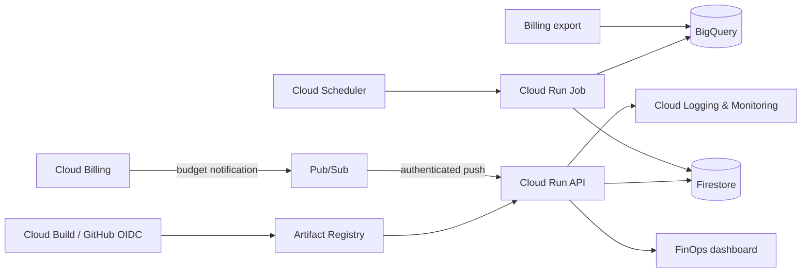

# CloudSpend Sentinel

CloudSpend Sentinel is a cost-aware operations platform for Google Cloud. It turns Cloud Billing budget events and cost exports into service-level insights, anomaly alerts, and an investigation playbook.

This repository is intentionally designed as a production-style cloud engineering portfolio project rather than a tutorial application. It demonstrates serverless architecture, event-driven integration, least-privilege IAM, infrastructure as code, automated testing, observability, and cost controls.

## What it does

- Attributes spending to individual Google Cloud services.
- Detects unusual service-level cost increases against a recent baseline.
- Accepts the Pub/Sub envelope used by Cloud Billing budget notifications.
- Produces targeted investigation recommendations for Compute Engine, Cloud Run, BigQuery, and networking.
- Provides a responsive operations dashboard and a safe budget-event simulator.
- Runs locally without a billing account and scales to zero when deployed to Cloud Run.

## Target architecture



The checked-in application currently uses a memory-backed repository seeded with realistic demo data. Firestore persistence and scheduled BigQuery analysis are the next cloud-integration milestone; the HTTP and domain layers are already separated so the storage backend can change without rewriting the dashboard.

## Local demonstration

Requirements: Node.js 22 or newer. There are no runtime package dependencies.

```bash
npm test
npm start
```

Open `http://localhost:8080`, inspect the detected Compute Engine anomaly, and select **Simulate budget alert**. The alert is accepted through the same ingestion route used for Cloud Billing notifications.

Useful endpoints:

| Endpoint | Purpose |
|---|---|
| `GET /api/health` | Health check for Cloud Run |
| `GET /api/summary` | Budget, attribution, anomaly, and alert summary |
| `GET /api/costs` | Normalized cost observations |
| `POST /api/budget-events` | Cloud Billing Pub/Sub ingestion |
| `POST /api/simulate` | Portfolio demonstration event |

Set `INGEST_TOKEN` to require `Authorization: Bearer <token>` on ingestion routes outside Cloud Run IAM.

## Quality and security controls

- The container runs as the unprivileged `node` user.
- Cloud Run scales from zero to a maximum of one instance by default.
- The Terraform deployment is private by default.
- Pub/Sub invokes the service through a dedicated service account.
- Runtime IAM roles are deliberately separated from deployment permissions.
- API request bodies are size-limited and budget data is validated.
- CI runs application tests, syntax checks, and Terraform validation.
- The infrastructure can be recreated and destroyed through Terraform.

## Repository map

```text
public/                 Dashboard assets
src/domain/             Cost analysis and budget-event normalization
src/http/               HTTP routes and Pub/Sub envelope handling
src/store/              Replaceable data repository
test/                   Domain and API tests
infra/terraform/        Google Cloud infrastructure
docs/                   Architecture, threat model, cost plan, and runbook
.github/workflows/      CI and manual deployment pipelines
```

## Google Cloud deployment

The deployment is split into two deliberate steps so that infrastructure creation never triggers an accidental build or release.

1. Create a dedicated Google Cloud project and configure the billing guardrails in [`docs/cost-plan.md`](docs/cost-plan.md).
2. Copy and edit the Terraform example variables:

   ```bash
   cd infra/terraform
   cp terraform.tfvars.example terraform.tfvars
   terraform init
   terraform plan
   terraform apply
   ```

3. Build and deploy the application through the manually triggered GitHub workflow or Cloud Build:

   ```bash
   gcloud builds submit --config cloudbuild.yaml \
     --substitutions=_REGION=us-central1,_RUNTIME_SERVICE_ACCOUNT=cloudspend-runtime@PROJECT_ID.iam.gserviceaccount.com
   ```

4. Verify `/api/health`, trigger a test budget event, capture the dashboard evidence, and follow the teardown section in the runbook.

Do not commit `terraform.tfvars`, service-account keys, billing exports, or secrets.

## Portfolio evidence

Before publishing the repository, add the following to `docs/evidence/`:

- Cloud Run revision and scaling settings
- Authenticated Pub/Sub delivery
- A budget alert displayed in the dashboard
- Cloud Logging request entries
- Monitoring dashboard and alert policy
- Terraform plan summary
- Actual cost report grouped by service

## Documentation

- [Architecture and design decisions](docs/architecture.md)
- [Threat model](docs/threat-model.md)
- [Operations runbook](docs/runbook.md)
- [Cost plan and guardrails](docs/cost-plan.md)
- [Résumé and interview notes](docs/resume-notes.md)

## Current status

- [x] Tested cost-analysis engine
- [x] Responsive operations dashboard
- [x] Budget-event and Pub/Sub ingestion API
- [x] Container definition
- [x] Terraform foundation
- [x] CI and manual deployment workflows
- [ ] Firestore persistence adapter
- [ ] Scheduled BigQuery cost-analysis job
- [ ] Cloud Monitoring dashboard and alert policy
- [ ] Recorded cloud demonstration and final cost report

## License

MIT
